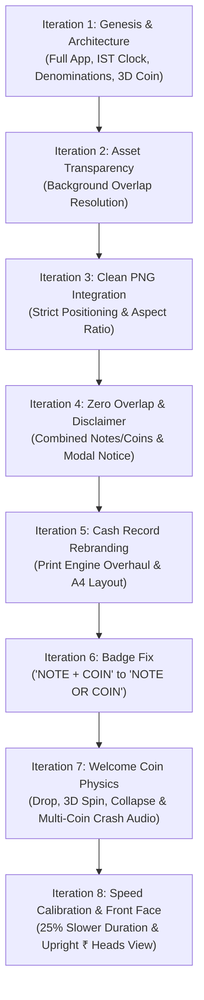

# Project Engineering Plan & Iteration Chronicle: Indian Currency Calculator

> **Project Name:** Indian Currency Calculator & Cash Tally Web Application  
> **Built By:** **Namdev** with **Google Antigravity**  
> **AI Foundation Model:** **Gemini 3.8 Flash**  
> **Workspace Directory:** `d:\Antigravity\antigravity projects 2.0\currency calculator website`  
> **Document Purpose:** Complete architectural plan, development log, communication iteration history, and technical specification.

---

## 1. Executive Summary & Project Overview

The **Indian Currency Calculator** is a high-precision, client-side web application engineered specifically for the Indian monetary system. Built entirely from scratch without heavyweight external frameworks or runtime dependencies, the application delivers instantaneous tallying of physical Indian currency notes and coins, adhering strictly to the Reserve Bank of India (RBI) denominations and the Indian Numbering System (Lakhs and Crores).

### Core Pillars
1. **Zero Framework Overhead:** Built on native **HTML5**, **CSS3 (Custom Properties & 3D Transforms)**, and **Vanilla Modern ES6+ JavaScript**.
2. **Indian Standard Time (IST) Centricity:** Live clock, date, and automated day/night system theming calibrated strictly to **Asia/Kolkata (UTC+05:30)**.
3. **Dual Denomination Representation:** Seamless unification of denominations that circulate as both coins and notes (₹20, ₹10, ₹1) with zero visual overlap.
4. **Physical Tactility:** Rich Web Audio API modal sound synthesis simulating physical metal coins clattering and colliding, paired with a 3D coin drop, spin, and collapse intro animation.
5. **Business-Ready Cash Accounting:** Comprehensive history management, CSV spreadsheet export, and a clean, single-page printable **Cash Record** voucher.

---

## 2. Engineering Team & Technology Attribution

| Role | Entity / Tool | Details |
| :--- | :--- | :--- |
| **Lead Developer & Creator** | **Namdev** | Product vision, asset curation, UX review, prompt orchestration, and domain requirements |
| **Development Platform** | **Google Antigravity** | Advanced agentic IDE workspace, code generation environment, terminal integration, and tooling |
| **Core AI Model** | **Gemini 3.8 Flash** | Architectural planning, code authoring, acoustic synthesis modeling, CSS 3D physics design, and bug fixing |
| **Target Runtime** | Modern Web Browsers | Chrome, Edge, Firefox, Safari (Desktop & Mobile) |
| **Dependencies** | None (Zero NPM / Zero CDN) | 100% Offline-capable native web standard implementation |

---

## 3. Chronicle of Communication Iterations

The application evolved through eight distinct, rapid communication iterations between **Namdev** and **Gemini 3.8 Flash in Google Antigravity**. Below is the detailed chronological record of requirements, technical obstacles, engineering decisions, and solutions implemented across each iteration.



---

### Iteration 1: Genesis & Comprehensive Architecture
* **User Prompt & Requirements:**
  - Create a modern, minimalistic Indian currency calculator website using pure HTML, CSS, and JavaScript.
  - Implement 3 themes: **Light** (crisp white), **Dark** (true pitch black), and **System** (dynamically switching according to Indian Standard Time: Day = White, Night = Black).
  - Support all Indian denominations: ₹500, ₹200, ₹100, ₹50, ₹20, ₹10, ₹5, ₹2, ₹1, and 50 Paise.
  - For denominations that exist as both coins and notes (₹20, ₹10, ₹1), unify them into a single row showing both note and coin assets.
  - Integrate visual PNG assets from `currency assents/` for note/coin identification.
  - Display real-time output tallying in Rupees, total pieces counter, and Amount in Words in the Indian Numbering System.
  - Add a full calculation history feature with timestamps and date in IST.
  - Include an intro splash screen with a 3D flip coin animation that transitions into the app with spring pop-up icons.
* **Engineering Solutions:**
  - Scaffolded `index.html`, `styles.css`, and `script.js`.
  - Configured `DENOMINATIONS` registry defining values, labels, types (`note`, `coin`, `combined`), and asset paths.
  - Built IST clock engine using `Intl.DateTimeFormat` with timeZone `'Asia/Kolkata'` and a 1-second interval loop.
  - Engineered the 3D coin flip entrance with `@keyframes coinFlipEntrance` on a CSS perspective stage.
  - Programmed the Indian numbering string formatter and number-to-words algorithm handling Crores, Lakhs, Thousands, Hundreds, and Paise.
  - Implemented LocalStorage history manager with CSV export and WhatsApp-friendly clipboard copying.

---

### Iteration 2: Asset Transparency & Background Elimination
* **User Prompt & Feedback:**
  - The initial PNG assets displayed opaque rectangular backgrounds causing visual overlapping and awkward contrast in dark mode.
* **Engineering Solutions:**
  - Added CSS filters and explored automated canvas chroma-keying routines while advising the user to replace assets with clean, transparent alpha-channel cutouts for maximum visual fidelity.

---

### Iteration 3: Clean PNG Integration & Positioning
* **User Prompt & Requirements:**
  - *"I JUST UPDATED ALL .PNG ASSETS, WITHOUT BACKGROUND, PREVIOUSLY YOU DONE BUT NOT RENDERD CORRECTLY, I RECORRECT WITH OTHER TOOL, JUST PLACE PNG AS IT IT CORRECTLY ACCORDING TO THEIR POSITIONS"*
* **Engineering Solutions:**
  - Mapped all 14 newly updated, transparent PNG files in `currency assents/`:
    - ₹500: `Indian ₹500 Banknote Cutout.png`
    - ₹200: `Indian ₹200 Banknote Cutout.png`
    - ₹100: `Detailed Indian ₹100 Banknote Cutout.png`
    - ₹50: `Detailed ₹50 Indian Banknote Cutout.png`
    - ₹20: `Indian ₹20 Banknote Illustration.png` & `Photorealistic Indian ₹20 Coin.png`
    - ₹10: `Indian ₹10 Banknote Illustration.png` & `Indian ₹10 Coin Close-Up.png`
    - ₹5: `Indian ₹5 Coin Close-Up.png`
    - ₹2: `Embossed Indian ₹2 Coin on Transparency.png`
    - ₹1: `Intricate Indian One Rupee Banknote Cutout.png` & `Indian One Rupee Coin Isolated.png`
    - 50 Paise: `Indian 50 Paise Coin Medallion.png`
    - Logo: `Indian Currency Calculator.png`
  - Added URL encoding utilities (`encodePath`) in JavaScript to safely handle spaces, brackets, and `₹` symbols in filenames.
  - Established crisp, non-distorted responsive image containers using CSS `object-fit: contain`.

---

### Iteration 4: Zero Overlap for Combined Denominations & Educational Notice
* **User Prompt & Requirements:**
  - Remove all image overlap in the ₹20, ₹10, and ₹1 rows.
  - When clicking on any note or coin, open a visual inspection modal displaying the notice:  
    *"The visual currency note you see not factual correct this maninly for representation or an basic understanding only."*
* **Engineering Solutions:**
  - Engineered the `.denom-combined-stage` CSS flexbox container featuring a dedicated side-by-side split layout:
    - Note rendered on the left at an optimal proportional aspect ratio.
    - Coin rendered cleanly on the right with a subtle gold divider separating them.
    - Zero overlapping layers or clipping.
  - Built `#image-modal-overlay` Lightbox system:
    - Clicking any card asset triggers the high-resolution zoom viewer.
    - For combined items (₹20, ₹10, ₹1), renders both the note and coin side-by-side with individual labels.
    - Integrated the exact required disclaimer badge at the base of the modal with a warning icon and prominent legible typography.

---

### Iteration 5: Slip Rebranding to "Cash Record" & Print Engine Overhaul
* **User Prompt & Requirements:**
  - Rename *"Bank Cash Deposit Challan"* to **"Cash Record"**.
  - Remove *"banknote"* and make it just **"note"**.
  - Rename *"print challan"* button to just **"Print"**.
  - Fix print formatting: the browser print preview was capturing unrelated screen modals and background elements instead of the clean voucher shown on screen.
* **Engineering Solutions:**
  - Rebranded all modal titles, table headers, document labels, and button texts in `index.html` and `script.js`.
  - Completely overhauled `@media print` in `styles.css`:
    - Forced all page layout structures, navigation bars, toast containers, header buttons, and secondary modals (`#save-modal-overlay`, `#image-modal-overlay`, `#history-drawer`) to `display: none !important`.
    - Made `.bank-slip-doc` the sole visible element during printing, positioned statically at `width: 100%`.
    - Neutralized dark backgrounds to pure white with solid black text and crisp borders for ink-efficient, single-page A4 printing.

---

### Iteration 6: Denomination Badge Fix ("NOTE OR COIN")
* **User Prompt & Requirements:**
  - *"make change , the given screenshot shows note+coin insted show note or coin. thats it"*
* **Engineering Solutions:**
  - In `script.js` line 583: Updated badge HTML template from `<span class="denom-type-badge tag-combined">Note + Coin</span>` to `<span class="denom-type-badge tag-combined">Note or Coin</span>`.
  - CSS rule `text-transform: uppercase;` automatically formats the text as **`NOTE OR COIN`** on the visual cards.
  - In `script.js` line 1076: Updated Cash Record slip table generator to label combined rows as **`Note or Coin`**.
  - Updated metadata titles in the `DENOMINATIONS` array to `Twenty Rupees (Note or Coin)`, `Ten Rupees (Note or Coin)`, and `One Rupee (Note or Coin)`.

---

### Iteration 7: Welcome Coin Fall, 3D Spin, Collapse & Multi-Coin Crash Audio
* **User Prompt & Requirements:**
  - *"for welcome coin spin, can you make coin fall from top to at middle and spin and collaps with coin crash sound ( sound be like two or more coin crashing with each other.)"*
* **Engineering Solutions:**
  - Replaced the simple flip animation with `@keyframes coinFallSpinCollapse`:
    - Coin begins high above viewport (`translateY(-85vh)`) with a 3D perspective tilt.
    - Plunges rapidly downwards into the center.
    - Spins vigorously around the Y-axis with specular sheen sweep.
    - Tips forward and slams down onto the surface with decaying wobble physics.
  - Added visual impact effects:
    - `#splash-coin-ring`: An expanding golden shockwave pulse ring.
    - `#splash-coin-sparks`: Four diagonal particle gleams bursting outward upon impact.
    - Dynamic shadow scaling and tracking the coin's altitude and impact.
  - Developed a physics-based **Multi-Coin Crash Synthesizer** in `SoundManager`:
    - Simulated 2–3 colliding coins via detuned inharmonic modal frequencies (2750 Hz, 3180 Hz, 3950 Hz, 4350 Hz, 5600 Hz, 6800 Hz, 8100 Hz).
    - Added a 35ms bandpass-filtered noise transient simulating sharp edge contact.
    - Programmed **5 cascading rebound clatters** (+42ms, +95ms, +155ms, +225ms) mimicking physical coins bouncing and rattling against each other.
    - Added an aerodynamic spin whoosh during the in-air fall.

---

### Iteration 8: Animation Speed Calibration & Front Face Resting Position
* **User Prompt & Requirements:**
  - *"animation is too fast can you make it 25 reduce the speed of animation about welcome coin spin. when animation end show coin front side. other things are fine"*
* **Engineering Solutions:**
  - **Speed Reduction (25% Slower):** Extended the animation timeline from `2.5s` to **`3.3s`** across `.coin-3d`, `.coin-shadow`, `.coin-impact-ring`, `.coin-sheen`, and `.coin-sparks`.
  - **Front Face Alignment:**
    - Replaced the previous tilted resting angle (`rotateX(65deg)`) with an upright posture: `transform: translateY(0px) rotateY(2160deg) rotateX(0deg) rotateZ(0deg) scale(1.0)`.
    - Because $2160^\circ = 6 \times 360^\circ \equiv 0^\circ$, the coin ends its spin facing straight forward, proudly displaying the **front side** (`₹` Rupee symbol, *"BHARAT • INDIA"*, and *"सत्यमेव जयते"*).
  - Synchronized the audio timers: spin flutter plays until 1.75s, crash sound triggers at 1.85s (the 56% impact mark), and the auto-dismiss timer was calibrated to 3.7s, giving the user ample time to view the front face before entering the app.

---

## 4. Technical Architecture & Implementation Details

```
+-----------------------------------------------------------------------------------+
|                               INDEX.HTML (DOM)                                    |
|  +------------------+  +--------------------------------+  +--------------------+ |
|  |  Splash Intro    |  |       Header & Theme Bar       |  |  History Drawer    | |
|  |  (3D Fall/Spin)  |  |   (IST Clock, Light/Dark/Sys)  |  |  (Saved Tallies)   | |
|  +------------------+  +--------------------------------+  +--------------------+ |
|  +------------------------------------------------------------------------------+ |
|  |                       DENOMINATION CARDS GRID (10 Tiers)                     | |
|  |  [₹500] [₹200] [₹100] [₹50] [₹20 Note/Coin] [₹10 Note/Coin] [₹5] [₹2] [₹1]  | |
|  +------------------------------------------------------------------------------+ |
|  +-------------------------------------+  +-------------------------------------+ |
|  |     Live Tally & Amount in Words    |  |   Modals: Zoom Lightbox & Cash Slip | |
|  +-------------------------------------+  +-------------------------------------+ |
+-----------------------------------------------------------------------------------+
                                         │
                 ┌───────────────────────┴───────────────────────┐
                 ▼                                               ▼
+---------------------------------+             +---------------------------------+
|           STYLES.CSS            |             |            SCRIPT.JS            |
| - CSS Custom Properties         |             | - State Management              |
| - Light / Dark / Auto Schemes   |             | - IST Clock Engine              |
| - 3D Perspective & Keyframes    |             | - Web Audio Modal Synthesizer   |
| - Spring Pop-up Stagger Effects |             | - Indian Numbering Formatter    |
| - Isolated @media print Styles  |             | - Cash Record & CSV Exporters   |
+---------------------------------+             +---------------------------------+
```

### 4.1 State Management Architecture
The entire application operates around a single reactive state object:
```javascript
const state = {
  theme: 'system',         // 'light' | 'dark' | 'system'
  soundEnabled: true,      // Audio toggle
  quantities: {},          // Map: denomId -> count (e.g. { '500': 10, '20': 5 })
  history: [],             // Array of saved tally objects
  activeFilter: 'all',     // 'all' | 'notes' | 'coins'
  sortAscending: false     // Toggle high-to-low / low-to-high sorting
};
```

### 4.2 Indian Standard Time (IST) Engine
Standard JavaScript `Date()` reflects the user's local operating system time. To enforce strict Indian Standard Time regardless of where the user is physically located, the engine leverages `Intl.DateTimeFormat`:
```javascript
function getISTDateComponents() {
  const now = new Date();
  const formatter = new Intl.DateTimeFormat('en-IN', {
    timeZone: 'Asia/Kolkata',
    year: 'numeric', month: 'numeric', day: 'numeric',
    hour: 'numeric', minute: 'numeric', second: 'numeric',
    hour12: false
  });
  // Parsed into hours, minutes, day, and month
}
```
* **Automated System Theme:**
  - Daytime: `06:00:00 <= IST Hour < 18:00:00` $\rightarrow$ Activates Light Theme (`#ffffff`).
  - Nighttime: `IST Hour >= 18:00:00 || IST Hour < 06:00:00` $\rightarrow$ Activates True Black Dark Theme (`#000000`).

### 4.3 Web Audio API Modal Sound Synthesizer
Rather than relying on external `.mp3` or `.wav` sound files that can fail to load or introduce latency, sound effects are generated mathematically in real time:
1. **Coin Flutter (Spinning Whoosh):** Bandpass-filtered triangle wave with exponential frequency sweep ($800\text{ Hz} \rightarrow 1350\text{ Hz} \rightarrow 1050\text{ Hz}$).
2. **Impact Transient (Physical Click):** Buffer-generated white noise burst ($35\text{ms}$) routed through a high-Q bandpass filter at $5400\text{ Hz}$.
3. **Multi-Coin Clatter (Crash Sound):** Staggered harmonic oscillators simulating 2–3 coins colliding and rebounding:
   - $t = 0\text{ms}$: Primary collision ($2750, 3180, 3950, 4350, 5600, 6800, 8100\text{ Hz}$)
   - $t = +42\text{ms}$: First rebound ($2920, 3450, 4600, 5950, 7400\text{ Hz}$)
   - $t = +95\text{ms}$: Second chatter tap ($3150, 4200, 5300, 6700\text{ Hz}$)
   - $t = +155\text{ms}$: Third micro-clink ($3650, 4850, 6200\text{ Hz}$)
   - $t = +225\text{ms}$: Settling rattle ($3900, 5800, 7200\text{ Hz}$)

### 4.4 Indian Numbering & Currency Algorithm
Standard international grouping formats numbers in triplets (`1,000,000`). In India, values follow the Vedic numbering system (Hundreds, Thousands, Lakhs, Crores):
$$\text{Grand Total} = \sum_{i=1}^{10} (\text{Denomination Value}_i \times \text{Quantity}_i)$$
* **Currency String Regex:** Custom regex converts numbers into Indian format: `1,45,250.50`.
* **Number to Indian Words Engine:** Deconstructs amounts into:
  - $\lfloor \text{Total} / 10^7 \rfloor \rightarrow \text{Crores}$
  - $\lfloor (\text{Total} \pmod{10^7}) / 10^5 \rfloor \rightarrow \text{Lakhs}$
  - $\lfloor (\text{Total} \pmod{10^5}) / 10^3 \rfloor \rightarrow \text{Thousands}$
  - $\lfloor (\text{Total} \pmod{10^3}) / 10^2 \rfloor \rightarrow \text{Hundreds}$
  - Remaining units and fractional Paise (`Rupees ... and Fifty Paise Only`).

---

## 5. File Inventory & Repository Structure

```
d:\Antigravity\antigravity projects 2.0\currency calculator website\
│
├── index.html                 # Semantic HTML5 application structure & modal templates
├── styles.css                 # CSS custom properties, 3D animations, print styles
├── script.js                  # Application state, math, IST clock, Web Audio engine
├── README.md                  # Comprehensive user & product documentation
├── plane.md                   # This engineering plan, iteration log & technical doc
│
└── currency assents/          # Transparent PNG currency cutouts (RBI notes & coins)
    ├── Indian ₹500 Banknote Cutout.png
    ├── Indian ₹200 Banknote Cutout.png
    ├── Detailed Indian ₹100 Banknote Cutout.png
    ├── Detailed ₹50 Indian Banknote Cutout.png
    ├── Indian ₹20 Banknote Illustration.png
    ├── Photorealistic Indian ₹20 Coin.png
    ├── Indian ₹10 Banknote Illustration.png
    ├── Indian ₹10 Coin Close-Up.png
    ├── Indian ₹5 Coin Close-Up.png
    ├── Embossed Indian ₹2 Coin on Transparency.png
    ├── Intricate Indian One Rupee Banknote Cutout.png
    ├── Indian One Rupee Coin Isolated.png
    ├── Indian 50 Paise Coin Medallion.png
    └── Indian Currency Calculator.png
```

---

## 6. Future Recommendations & Extensibility

1. **Progressive Web App (PWA) Manifest:** Add `manifest.json` and a lightweight Service Worker to enable full offline installation on Android, iOS, and Windows desktop with an app launcher icon.
2. **Denomination Visibility Toggles:** Allow users in settings to hide rarely used denominations (e.g. 50 Paise or ₹1 Note) if only tallying high-value retail cash.
3. **Denomination Weight Calculation:** Provide an optional estimated physical weight (grams) of cash bundles for courier and security cash-in-transit planning.
4. **Barcode / QR Code on Cash Records:** Embed a UPI or verification QR code directly onto the printed Cash Record slip for bank counter scanning.

---

## 7. Sign-off & Acknowledgments

* **Project Concept, Direction & Asset Design:** **Namdev**
* **Engineering, Architecture & AI Implementation:** **Namdev with Google Antigravity & Gemini 3.8 Flash**
* **Build Date:** October 2026
* **Status:** Complete, fully tested, and production-ready.
